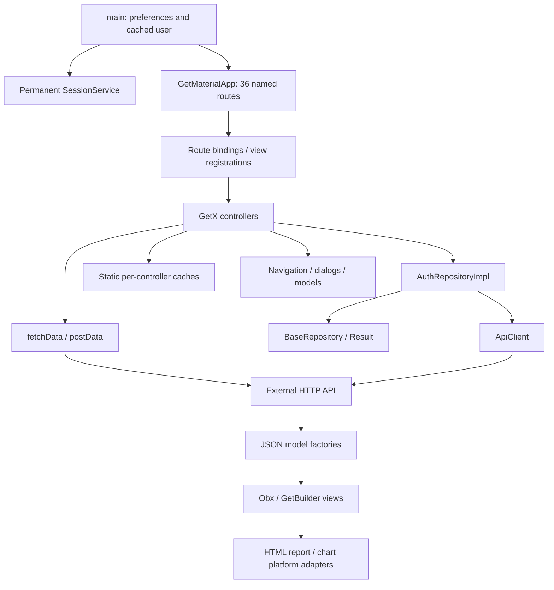

# Architecture, API, and data assessment

The application has a workable feature-oriented Flutter/GetX structure. The main maintenance risk is inconsistent ownership of transport, session data, and form drafts—not the choice of GetX itself. Incremental consolidation is justified; a complete rewrite is not supported by this audit.

## Current execution model

Source anchors: [main.dart:69](/Users/alimegahed/power_saving/lib/main.dart:69), [SessionService](/Users/alimegahed/power_saving/lib/global/data.dart:10), [legacy transport](/Users/alimegahed/power_saving/lib/network/network.dart:16), [ApiClient](/Users/alimegahed/power_saving/lib/core/network/api_client.dart:9). The source inventory contains the complete route/binding and API call-site tables.

## Boundaries and design quality

| Area | Evidence and assessment | Direction |
|---|---|---|
| Feature organization | Most domains have model/controller/view/binding directories; planning and billing contain several subflows. This supports gradual improvement. | Retain feature boundaries; make external dependencies explicit. |
| Dependency direction | Infrastructure imports UI helpers/login. Planning controller imports result screens, which import its controller. Report widgets import their parent screen for base classes. Three cyclic import components are recorded. | Move report contracts to a neutral module; return results instead of navigating from transport; separate navigation coordination from data access. |
| Repository abstraction | AuthRepository isolates login/password signatures, but BaseRepository performs dialogs/navigation and most features bypass it. | Introduce a common transport and a few business repositories according to actual duplication, without adding ceremonial layers to every file. |
| Dependency injection | Route bindings coexist with Get.put in views and controllers. Some bindings use lazy creation; Bills.onInit is manually called from UI. | Let one route/session owner register and dispose each dependency. Inject interfaces into controllers rather than instantiate concrete repositories inside them. |
| State ownership | Rx lists coexist with ordinary lists/GetBuilder.update, permanent SessionService aliases, static JSON caches, and form controllers. | Separate session state, server resource state, and unsaved form drafts. Use explicit state transitions and cache keys. |
| Cohesion | Meter screen is 1,289 lines and includes the billing form and payload construction; home is 1,715 lines; ML result screen is 1,097 lines. Size alone is not a defect, but billing UI already causes listener/data errors. | Extract billing draft/calculation first; then stable sections with clear inputs and outputs. |
| Duplication | Two classes named Techbills in different controller paths; Station models exist in station-related controllers as well as the model layer; similar CRUD/cache/search implementations repeat. | Identify active call sites before removing legacy code. Consolidate shared contracts and policies, not every visual difference. |
| Design system | AppTheme, AppColors, AppDimensions, shared cards and form helpers exist, but many screens override styles. ResponsiveWrapper and AccessibleFocusWrapper have no call sites found. | Adopt existing tokens and components deliberately, and remove misleading unused infrastructure only in a future authorized change. |
| Testability | HTTP injection exists in ApiClient, but repositories trigger UI side effects and controllers self-register concrete implementations. | Make calculations pure and transport fakeable; keep dialogs out of tests of network semantics. |

These points map to ARCH-01, DATA-02, DATA-04, LIFE-01, and QA-01 in the finding register. Cycles are coupling evidence, not a claim of an invalid Dart architecture. No inherent problem is inferred merely from mixed Obx/GetBuilder usage.

## Traced user journeys

1. **Sign in and reload:** Login form → LoginController → AuthRepositoryImpl → ApiClient.post(`/login`) → JSON current_user/token → SharedPreferences → SessionService user → `/home`. Startup restores cached user before `runApp`; no server validation occurs before selecting `/home`. Cache writes occur before `User.fromJson` validates the entire response, and preference write success is not inspected. A partial/malformed login response can leave partial persisted state. See SEC-01, SEC-05, SEC-06.
2. **Meter bill creation:** `/Countrts` → meter card → manually initialized Bills controller → GET bill prerequisites → dialog replaces text controllers → calculation listeners → GuageBill.toJson → POST bill → invalidate AllBills cache. The meter catalog/cache itself is not refreshed by bill success; whether its final reading is server-updated requires an API contract. Rollover, listener replacement and stale total defects are confirmed (DATA-01–03). The history-screen Add Bill route is missing (UX-01).
3. **Technology bill entry:** station/technology references → form controllers → insert-or-edit endpoint → history cache invalidation. The operational per-card editor uses a different controller/cache and integer-index drafts, then refreshes all rows after save. Draft identity and cross-cache refresh need a single policy (DATA-05). An older duplicate Techbills implementation is not assumed active solely because it exists.
4. **Planning:** balance route → independent area/place-type reads → editable reference-driven fields/future capacity rows → request body → balance calculation endpoint → WaterDataResponse or MLForecastResponse → print/result screen. Reference refresh can erase inputs (DATA-04). `buildRequestBody()` uses `int.parse` before submitData's try block; current ministry field validators reject non-integers, so this is a defensive boundary weakness rather than a confirmed reachable UI crash.
5. **Reports:** type/date selection → POST `/reports` → per-row model parsing → filter lists → locally computed totals → table/printer strategy → HTML Blob. Partial rows, export counts, HTML encoding and scaling issues are documented separately (DATA-07, UX-05, SEC-03, PERF-01).
6. **Reference maintenance:** add/edit stations, meters, technologies, places and chemicals → controller-owned form → legacy POST → domain cache invalidation. Success handling often accepts only status 200 although transport accepts all 2xx; correctness depends on server contracts. A documented 201 response could be treated as an error by these forms. Do not generalize this to NewTechBillsController, which explicitly accepts 200/201.
7. **Analysis and prediction:** station selection → analysis/prediction endpoint → JSON chart data/base64 or HTML → result widgets. Analysis fetch starts in build; error/empty/loading state is incomplete (REL-01). Predictions retain their previous prediction model on failure; verify selected-station labeling before treating prior results as current.

## API and integration controls

| Control | Current observation |
|---|---|
| Authentication | Bearer token from preferences; no implemented refresh-token exchange or session-expiry scheduler found. Token format/expiry contract is unknown. |
| Authorization | Group-based menu visibility; no route middleware; server rules absent. Client changes cannot substitute for backend checks. |
| Timeout | Authentication client has a 15-second per-attempt timeout; legacy feature requests do not. This is a code constant, not measured latency. |
| Retry | ApiClient retries transport/generic failures up to three attempts, including POST. AppException responses are rethrown rather than retried. |
| Pagination | `/view-bills` and `/view-tech-bills` send page/per_page plus filters. Catalogs, reports and operational tech bills load lists without client pagination. |
| Filtering | Bill history filters are server-side; catalog/report filtering is local; search debounce exists in several controllers. One operational search is miswired. |
| Cancellation/order | No request-generation or session-generation response guards found on the traced flows. |
| Validation | Mixed direct dynamic JSON assignments, numeric defaults and explicit parsers. No OpenAPI/schema contract tests found. |
| Error semantics | 401 and 403 both invalidate only token; raw server messages/exceptions are shown in modal dialogs, sometimes at multiple layers. |
| Connectivity | OfflineBanner exists without usage; no offline write queue or connectivity/reconciliation policy found. Cached data can mask failed background refresh. |
| Versioning/configuration | Hardcoded host-selection logic and unversioned endpoint paths; no environment/flavor schema or server compatibility contract supplied. |
| File transfer | No user file-upload flow identified. HTML print and base64 chart content are the primary export/media boundaries. |
| External presentation | Google Fonts theme uses Almarai without bundled font assets declared. Exact network/font-cache behavior is not measured. |

## Data management and database limits

The repository is a client, not a database implementation. No claims are possible about production indexes, query plans, transactions, constraints, backup/restore, encryption at rest, row-level authorization, migrations or database availability. API payloads reveal station/technology/meter relationships, billing periods, reference chemical ranges, places/areas and users, but they do not establish database schema or referential integrity.

Client-side integrity risks are concrete: calculations can submit inconsistent bill totals; mutable row indexes can misassociate drafts; report parsing can omit rows; cached inputs can be overwritten. `GuageBill.fromJson` also substitutes a specific year (2024) when bill_year is missing, and report totals often substitute zero for absent values. These defaults can hide incomplete upstream data; classify them as contract risks until response schemas are established.

Recommendations for the eventual backend review: verify unique meter-period and technology-period constraints, atomically update bills and related readings, define decimal precision/rounding and measurement units, enforce numeric/range constraints server-side, and authorize every referenced station/account. Do not implement or assert those controls from frontend evidence alone.

The relation status action uses GET `/edit-relation/{id}` with success messaging and refresh. This strongly suggests an unsafe-method mutation contract, but the server implementation is absent. Verify semantics and migrate mutations to an appropriate write method; no such GET was invoked during this audit.
